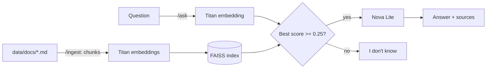

# Runbook Assistant

A small RAG service on Amazon Bedrock that answers questions about technical documentation and cites its sources. The app is deliberately simple: the point of this repository is how it is tested, packaged, deployed and operated (Docker, AWS with Terraform, CI/CD, Kubernetes).

## Status

- **Done:** the API runs locally, with tests that need no AWS credentials.
- **Next:** Docker image, CI with GitHub Actions and Trivy, AWS infrastructure with Terraform (ECS Fargate behind a load balancer), then the same service on Kubernetes.

## Run locally

### Requirements

- Python 3.12
- An AWS account with Amazon Bedrock access in `eu-north-1` to Titan Text Embeddings V2 and Amazon Nova Lite
- An AWS CLI profile with permission to call `bedrock:InvokeModel`

### Install

```bash
python3.12 -m venv .venv
source .venv/bin/activate
pip install -r requirements.txt
```

### Configure

```bash
export AWS_PROFILE=<your-profile>
export AWS_REGION=eu-north-1
export EMBEDDING_MODEL_ID=amazon.titan-embed-text-v2:0
export TEXT_MODEL_ID=eu.amazon.nova-lite-v1:0
```

> [!WARNING]
> Set these variables in every terminal tab that runs the app. A new tab starts without them and the app fails with `KeyError: 'AWS_REGION'`. No credentials are stored in the repository.

### Start the API

Run it from the repository root (paths are relative):

```bash
uvicorn main:app --reload
```

### Build the index

In a second terminal tab:

```bash
curl -X POST localhost:8000/ingest \
  -H "Content-Type: application/json" \
  -d '{"documents": ["pods.md", "deployments.md", "services.md"]}'
```

This calls Titan once per chunk (about 190 calls) and takes about two minutes. Expected answer:

```json
{"status":"ok","documents_count":3,"chunks_count":191}
```

To index your own documents, put Markdown or plain-text files in `data/docs/` and list their names in the request. Each call rebuilds the index from only the files you list.

Chunking and the `0.25` threshold were tuned on the Kubernetes documents; with other documents, retrieval quality may drop (see `eval/results.md`).

### Ask a question

```bash
curl -X POST localhost:8000/ask \
  -H "Content-Type: application/json" \
  -d '{"question": "What is a Pod?"}'
```

The answer comes with its sources (`"sources": ["pods.md"]`). A question the documents cannot answer returns `"I don't know"` without calling the text model.

> [!NOTE]
> `/ingest` and `/ask` call Amazon Bedrock and are billed to your AWS account (a few cents for these three documents).

## How it works



- `POST /ingest` reads documents from `data/docs/`, splits them into chunks, turns each chunk into a vector with Titan Text Embeddings V2 and stores the vectors in a FAISS index (`data/index/`).
- `POST /ask` turns the question into a vector, finds the 3 closest chunks and, if the best one is relevant enough (`MIN_SCORE = 0.25`), asks Amazon Nova Lite to answer using only those chunks. Otherwise it answers "I don't know" without calling the model.
- `GET /health` reports that the service is up.

## Testing and evaluation

```bash
pytest --cov=. --cov-report=term-missing
ruff check .
```

The tests replace the Bedrock calls with fakes, so they run without AWS credentials, as they will in CI. Coverage is 97%; the only uncovered lines are the real Bedrock calls, which are checked by hand.

`eval/questions.md` holds 6 questions with their expected sources (5 about Kubernetes, 1 off-topic); `eval/results.md` records the latest run: 6 of 6 correct. The `0.25` threshold was calibrated on those 6 questions only.

## License

The code is under the [MIT License](LICENSE). The documents in `data/docs/` come from the Kubernetes documentation under CC BY 4.0; see [`data/docs/ATTRIBUTION.md`](data/docs/ATTRIBUTION.md). This project is not affiliated with the Kubernetes project or the CNCF.
