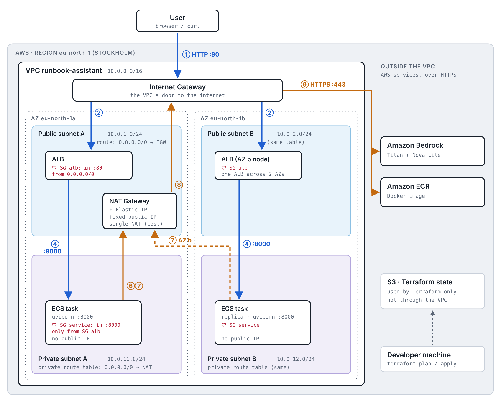

# Network

The target AWS architecture for runbook-assistant. The network is defined in
[`infra/app/network.tf`](../infra/app/network.tf); the README status lists which parts are built.

## What is in it

| Piece | Value | Why |
|---|---|---|
| VPC | `10.0.0.0/16`, region `eu-north-1` | One private network for the whole service. |
| Public subnets | `10.0.1.0/24` (AZ a), `10.0.2.0/24` (AZ b) | The load balancer needs subnets in two AZs. Their route table sends `0.0.0.0/0` to the Internet Gateway. |
| Private subnets | `10.0.11.0/24` (AZ a), `10.0.12.0/24` (AZ b) | The containers. Their route table sends `0.0.0.0/0` to the NAT Gateway, so nothing on the internet can reach them. |
| NAT Gateway + Elastic IP | One, in public subnet A | Outbound internet for the private subnets (Bedrock, ECR). One NAT instead of one per AZ to keep costs down; production would use one per AZ. |
| Security group `alb` | In: TCP 80 from `0.0.0.0/0`. Out: TCP 8000 to SG `service` | Anyone can call the API, and the ALB can only talk to the service. |
| Security group `service` | In: TCP 8000 from SG `alb` only. Out: all | Only the ALB can reach the containers. Security groups are stateful, so replies need no extra rules. |

## The two traffic paths

**Inbound, someone calls the API (blue):**

1. The user sends `POST /ask` to the ALB on port 80.
2. The request enters through the Internet Gateway and reaches the ALB in a public subnet.
3. The ALB forwards it to a container on port 8000 in a private subnet.
4. The response goes back the same way.

**Outbound, the container calls Bedrock (orange):**

1. The container calls Bedrock (or pulls its image from ECR) over HTTPS on port 443.
2. The private route table sends the request to the NAT Gateway.
3. The NAT swaps the source address for its Elastic IP.
4. The public route table sends it to the Internet Gateway, and from there it reaches Bedrock.
5. The NAT lets replies back in, but it never accepts new connections from outside.

## Cost

The NAT Gateway and its Elastic IP are billed per hour, roughly 0.05 USD/h together (estimate). The network is created with `terraform apply` for a work session and removed with `terraform destroy` at the end. After a destroy, check that no NAT Gateway or Elastic IP is left in the console.
